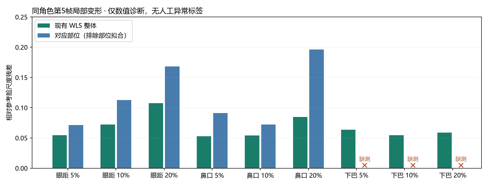
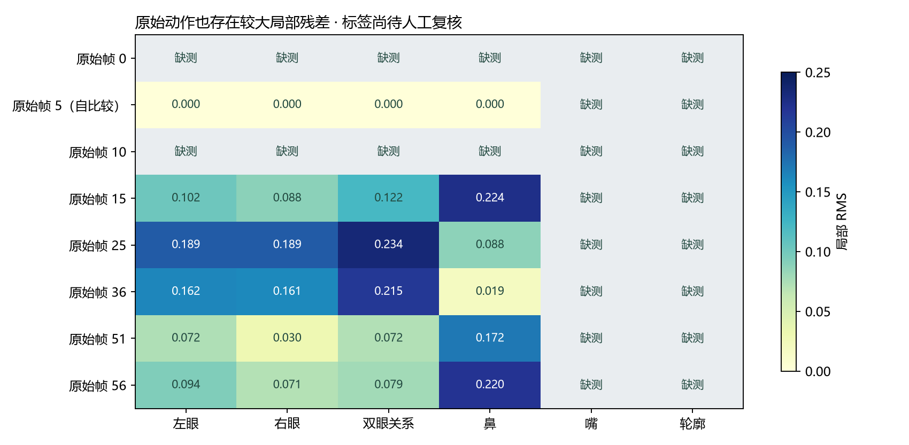
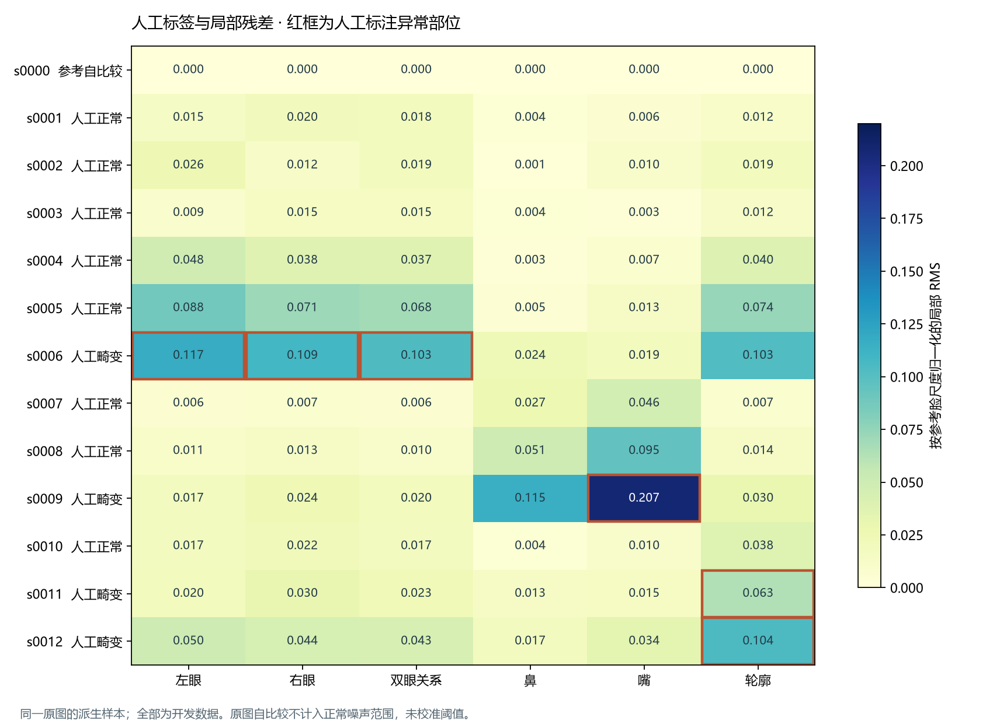
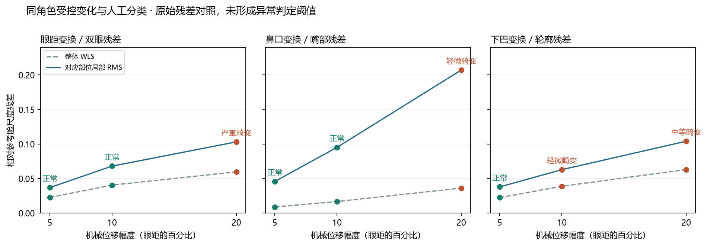

# 单角色局部几何与统计校准：实现与实测

2026-10-12 · 基于 c0f0d84 的独立离线研究

**新批次人工盲测已导入：9 张正常、4 张畸变；5% 误报目标未验收。** 清晰正脸原图已获人工确认，局部指标能保留一些被整体平均稀释的变化，但本批也发现了对齐导致的跨部位残差耦合。只有一个独立来源，没有正常校准或验证来源，不能据此宣称精度改善或给出可采用阈值。最新标签、对照图和实际阶段产物见第八节。

后续拟合耦合实验见第九节：理论导数与实际拟合一致；添加嘴角降低眼部到轮廓的污染，但同时引入嘴部到轮廓的污染，未形成可采用算法。

正脸续作见第十至十三节：新增轮廓内部比值候选，完成真实GMFlow图对、部位光流、合成时序回放及统计预算，并实际执行新候选的冻结／校准／评估。输入继续限定已人工标注的13张正脸图；独立来源不足，采用仍为not_accepted。

最新表达域与稳定性研究见第十四、十五节：六维轮廓已补全，额外33张正脸完成真实CPU观测及99次检测等变探针；四种度量、双边参考误差及有界正常范围都有条件明确的对照。新增图片没有人工异常标签，盲审依当前选择暂缓；这些结果没有增加正式校准／验证来源或证明异常检测精度提升。

局部对齐、姿态参考、盲审、分组、冻结／校准／独立评估流程已实现。早期62张GIF裁剪的初始执行记录保留于第二至六节；该素材因条带、抖色与构图问题已降级为回归／低质量输入压力测试。第七节记录清晰正脸批次的重新准备，不把旧标签移入新图。

本轮 Runtime、API、现有 geometry_distance、可信 checkpoint 和自动恢复行为均未修改。阶段命令与输入字段见 [使用说明](../../local-geometry-calibration.md)，原始素材／盲审页面／特征留在 var/local-geometry-study，提交版只包含数字、配置与图表。

## 1. 实现的能力与约束

| 阶段 | 实现 | 失败／不足时的行为 |
| --- | --- | --- |
| 数据准备 | 固定裁剪与帧号；同角色原始帧派生 3 部位、3 强度变换；预先固定统计主样本 | 没有可靠双眼时不制造变形，记录跳过 |
| 盲审与导入 | 匿名图、normal / geometry_anomaly / uncertain、姿态／模式／遮挡／部位／严重度；隐藏分数和变形名 | 未人工复核或分歧保持 uncertain；可保存人工裁决 |
| 分组 | 来源级 60/20/20、种子 42；父子继承；一来源最多一个原始主样本 | 重复源哈希、跨来源重复图、错误父子和重复主样本拒绝 |
| 局部对齐 | 排除被测部位拟合；正尺度、不反射、参考尺度、原始置信度评分 | 局部点不足或退化只使对应部位缺测 |
| 姿态与对照 | 开发集人工正常原图 medoid；分部位匹配成本与歧义门限；WLS / 单参考局部 / 自动姿态 / 人工 oracle | 不用鼻点偏移直接拒绝鼻部异常；无姿态库或歧义时未知，保留原始值 |
| 冻结与校准 | 校准前声明候选；绑定数据、标签、模型、实现、政策与参考；median/MAD、最大局部统计量、39 来源秩阈值 | 标签／数据／模型／配置变化拒绝旧产物，稀疏配置未校准 |
| 独立评估 | 正常主样本 FPR 与单侧 CP 上界、完整覆盖率、异常 unknown 算未检出；分层与配对来源 bootstrap | 分母为零返回 null，来源不足不计算可信区间，不采用 |

两个固定正脸基线使用固定正脸配置；自动姿态版本按实际匹配路由，只有 oracle 使用人工姿态真值，避免把真实姿态标签泄漏给自动算法。自动版本只允许开发时声明的候选参与采用，其他版本用于对照；人工 oracle 不进入采用。当前 28 点不含瞳孔，不虚构视线估计。

## 2. 同角色真实 CPU 输入

源为 [AniSora 固定版本 video_sr_video_3.gif](https://raw.githubusercontent.com/bilibili/Index-anisora/6cdce3a17548d7ff0f2e05978469f134da25e68e/assets/video_sr_video_3.gif)，固定裁剪 `(700,320)-(1250,1000)`，选 GIF 帧 0、5、10、15、25、36、51、56。素材是公开演示，不是本机 SkyReels 生成，也不保证所有画面为正常。

8 个原始帧中，0 和 10 没有可靠人脸；其余 6 帧各派生眼距、鼻口、下巴的 5%／10%／20% 局部位移，共 54 张变形，合计 **62 个样本**。位移单位为检测到的双眼中心距离，不改变画布大小。机械参数不等于人眼异常等级；这些变形仍等待人工分类。

真实提取两组件均 ready：**62/62 CCIP 特征成功，60/62 检出单脸**。一进程复用模型；模型校验／加载约 **7.14 秒**，总提取约 **129.14 秒**，期间运行了控制与算法测试，不是无同期负载的吞吐基准。准备阶段和统计处理不包含在该总时间中，没有 GPU 推理结果。

## 3. 局部数值提供了什么、没有证明什么

为生成诊断图，显式选择第 5 帧作未人工确认的实验参考。这只用于 explore，不进入可信参考组或正式阈值校准。



| 第 5 帧派生输入 | WLS 整体残差 | 对应局部残差 | 解读 |
| --- | --- | --- | --- |
| 眼距 5% | 0.05466 | 双眼 0.07113 | 局部值较整体大 |
| 眼距 10% | 0.07225 | 双眼 0.11281 | 本组随强度增大 |
| 眼距 20% | 0.10732 | 双眼 0.16818 | 保留较大局部变化 |
| 鼻口 5% | 0.05284 | 鼻 0.09116 | 仍受关键点测量波动影响 |
| 鼻口 10% | 0.05390 | 鼻 0.07229 | 非单调，不能假设强度与距离线性对应 |
| 鼻口 20% | 0.08465 | 鼻 0.19629 | 整体平均确实稀释了本例的鼻部变化 |
| 下巴 5%／10%／20% | 0.06346／0.05458／0.05897 | 轮廓不可用 | 参考下巴点不可靠，不填正常值 |



未经正式标注的原始动作帧同样有较大局部残差：第 25 帧双眼残差约 **0.23357**，第 15 帧鼻部约 **0.22440**，均高于上述某些变形。所有样本对当前参考的嘴部和轮廓都不可用，原因是参考目标点置信度不足。

所以本轮只能说：排除被测部位后保留了一些被整体平均稀释的变化；**单参考局部残差仍受姿态／检测波动影响，嘴与下巴的可观测性也没有解决。** 没有证据支持“新方法识别精度已经提高”。自动姿态库尚无人确认，真实素材上的自动姿态匹配质量未验证；其软件行为由明确的合成坐标测试验证。

## 4. 冻结、校准与评估的实际结果

本节保留旧GIF未标注阶段的执行结果。清晰正脸批次的已完成盲测与新阶段结果见第八节。

62 个样本来自同一原始 GIF，来源分组为 **开发 1、校准 0、验证 0**。预先选定的统计主样本为第 0 帧，不能事后改成模型能测的帧来刷覆盖率。62 个标签全部 pending_human，可信参考组为空。

真实执行 freeze → calibrate → evaluate 后：各方法／姿态配置的正常校准来源数为 **0**，每档缺至少 **39** 个可用独立正常校准来源；全部阈值 null／insufficient_data。误报率、误报上界、覆盖率、检出率均为 null；pose_local 被预先声明为候选，采用结论为 **not_accepted**。

| 进一步验收所需 | 当前状态 |
| --- | --- |
| 人工复核标签与确认正常参考 | 初始 62 个样本未复核；首版导出仅有勾选，分类仍全部 uncertain。当前停止对此批补标，先更换合格素材 |
| 姿态档正常开发主样本 | 当前只有一个来源，无法拟合 20 来源的可靠性诊断与正常尺度 |
| 每支持姿态档至少 39 个独立正常校准样本 | 当前 0；派生图片和 GIF 相邻帧不能补这个分母 |
| 独立正常验证 | 当前 0；即使零误报，也至少需 59 个独立有效观测才能使总体单侧95%上界约4.95% |
| 人工确认真实畸变与分组对照 | 尚无；合成变换不能替代真实异常检出验收 |

该结果符合数据约束，不是模型推理失败。数据不足时没有放宽 5% 目标，没有把助手标签改名为人工标签，也没有用同一个 GIF 拆帧完成统计验收。

## 5. 验证与复查入口

本地 Windows **92 passed、1 skipped**；跳过项为独立 opt-in 的真实模型测试，真实模型证据来自本轮 62 样本提取。Ruff、格式、mypy 10 个源模块、wheel/sdist 构建通过。新 23 项测试覆盖相似变换、反射、部位拟合隔离、表情独立、局部缺测、自动姿态路由、人工分歧、同源泄漏、校准排序、缺测组合、产物失效、来源 bootstrap、独立评估及人工标注导入。测试内的人类标签是显式合成夹具，不是实际人工标签。

Clopper–Pearson 数值实现与模型环境现有 SciPy beta 分位数对照，若干 n=10/59/100/1000、不同误报数样例的最大差约 **3.6e-15**；基本控制环境不新增 SciPy 依赖。盲审页面检查 62 张卡片、分数／变形名／叠图隐藏、JavaScript 语法有效。Runtime/API 的源文件差异为空。

| 提交版证据 | 内容 |
| --- | --- |
| [evidence.json](./evidence.json) | 62 样本数值摘要、哈希、来源、模型、环境与耗时；无原图／绝对路径 |
| [frozen.json](./frozen.json) | 实际空参考组、来源划分、绑定与已声明候选 |
| [calibration.json](./calibration.json) | 实际未校准配置和补数要求 |
| [evaluation.json](./evaluation.json) | 实际 null 统计、未采用理由与标签状态 |
| [使用说明](../../local-geometry-calibration.md) | 准备、盲审导入、提取、冻结／校准／评估命令 |

本地原始产物位于 var/local-geometry-study 的 dataset-v1、extraction-v1、diagnostics-v1，以及冻结／校准／评估各版本目录。每次复查使用新输出目录。先通过素材质检，再完成新数据盲审和独立来源采集；历史数值与产物保留。后续提交仍为研究 Draft，不合并；本轮不关闭 #14/#16/#21，也不将这项局部研究冒充这些 Issue 的完整验收。

## 6. 首版标注导入与素材质量复核

首版人工导出与现有数据哈希、62 个唯一样本 ID 均匹配，已保存并导入私有目录。分类为 uncertain 62 张；姿态、模式、遮挡均为 unknown 62 张；50 张勾选参考（7 原图、43 派生图），异常部位共右眼 12、左眼 1、鼻 1 次勾选。复核者确认只勾选了参考／部位，未填写分类下拉框。因此这是一份未完成的分类记录，不能从勾选推导 normal 或 geometry_anomaly。

导入后的 freeze → calibrate → evaluate 已实际执行：可信参考仍为空，阈值和误报／覆盖／检出统计仍为 null，采用结论仍为 not_accepted；开发 1、校准 0、验证 0 的来源划分未改。程序的 confirmed 状态只表示已提交一份无分歧的人工声明，不表示标签完整、素材合格或已通过统计验收。公开摘要见 [review-quality.json](./review-quality.json)，不包含复核者标识或原图。

在提出继续补填前，本轮重新查看完整 GIF、8 张原始裁剪及代表性 20% 变形，发现以下质量问题：

- 原图有明显网格抖色和彩色条带，影响五官边缘与人工细微判断；这些图适合观察低质量输入的失败，不能充当干净正常基准。
- 固定裁剪下角色大小、位置与姿态变化较大；低头帧脸部靠近画面边缘，构图与姿态同时变化，难以单独解释局部残差。
- Gaussian 像素位移同时影响附近头发、帽子或背景线条，机械变形不等于纯五官畸变。不能据变形强度直接指定视觉异常等级。
- 仅一段 GIF 的 8 个原始帧与 54 个派生样本，缺少同角色独立正常来源和真实异常来源；人工标签也无法弥补独立样本量。

**dataset-v1 停止用于主实验训练、正式阈值校准和检测精度验收，保留为流水线回归／低质量输入压力测试。** 先前“现有素材足以启动研究”的判断需要收窄为可运行工程诊断，不能据此要求复核者继续补完这批标签。

现有 public-anchor.png 是清晰正脸候选，local-anchor.png 是清晰近正脸候选，适合重新启动各自同图局部变形对照；它们与 GIF 角色不同，不能混入该 GIF 的同角色实验。一张正脸仍不足以验证姿态鲁棒性或训练泛化。下一批主实验必须先确定角色，取得清晰正脸、同角色正常动作与独立来源，复核素材和变形质量后再进行盲审；不通过质检的来源单独留作压力测试，不在看分数后换统计主样本。

盲审控件已改为中文，显示分类与未知字段汇总；新样本不再默认导出 uncertain，必须明确选择分类。新增 review-page 命令可从已导入清单恢复原有勾选，原始图页和导出文件不覆盖。局部研究相关测试 24 项通过（含新增页面续填测试）；这项改动没有加载模型或改变 Runtime 判定。

## 7. 已重做的清晰正脸盲测批次

已实际重建 dataset-front-v1，以现有512×512的 public-anchor.png 为唯一原始来源，保留原像素；新增三个相似变换对照及眼距／鼻口／下巴各5%、10%、20%的有限范围变形，共13张。同一角色原图与派生图不混入旧GIF角色，统计主样本在提取前固定为原图，全部归开发集。旧标注没有迁移，新批次尚待人工分类，不把变换记录当真值。

重新使用固定CPU模型提取，**13/13取得CCIP特征，13/13检出单脸，六组局部目标点均有13/13满足0.3下限**。这是目标点可用性，尚不是人工正常样本的判定覆盖率。校验／加载约4.953秒，总提取约25.265秒，含写盘及同期研究检查，不作为纯吞吐基准。匿名数字、绑定和质检摘要见 [frontal-redo.json](./frontal-redo.json)。

准备时收窄眼部纵向范围，避免宽位移场扰动上方大片头发；九张局部变形均验证作用椭圆外变化像素数为0，零位移重采样与原图逐像素相等。整批图已视觉检查，局部范围内邻近发梢／皮肤的连带变化仍由人工复核。相似变换只检验旋转／尺度影响，不表示已有真实左右转头、低头／抬头或眨眼／张嘴数据。

新的中文盲审页面已交付在私有数据目录：完整尺寸无损PNG、点击放大、人工批量设定共同姿态／模式／遮挡、按数据哈希的浏览器暂存，以及逐张明确分类后导出。恢复进度不恢复人工声明，不给新批次套用旧标签。补标旧62张停止，**对新13张的人工盲测仍是当前必须完成的步骤**；下一步使用新标签分析局部区分能力，并继续采集同角色动作和独立来源，5%验收要求不变。

本次研究测试 **28 passed**，新增静态图准备／裁剪与单源主样本保护、有限位移的远处像素保留和无折叠检查。真实OpenCV逐像素检查另行通过；JS合成DOM验证批量设置不推断分类、同批恢复／跨批隔离、存储失败仍可导出。未运行GPU生成或模型训练，Runtime／HTTP判定保持当前行为。

## 8. 完成人工盲测后的局部几何对照

13条标注的数据哈希与样本ID全部匹配；一名人工复核者确认正常9张、几何畸变4张、不确定0张。姿态均为正脸、模式均为idle、遮挡均为none。四个异常为眼距20%（严重，左右眼及双眼关系）、鼻口20%（轻微，人工标为嘴部）、下巴10%（轻微）和下巴20%（中等）。其余机械变换被人工判为正常，没有将所有变换自动标成异常，也没有按变换名代填异常部位。

正常原图s0000获准成为正脸参考。另八张正常派生图虽然勾选了参考，仍按非原图规则排除；最终可信参考只有s0000。复用输入／模型绑定一致的真实提取产物，实际执行新版本 freeze → calibrate → evaluate。候选保持此前声明的pose_local，没有根据这批标签改选算法。完整配置和原始特征留在私有目录，公开冻结信息只含绑定与参考哈希。





| 输入／人工分类 | 整体 WLS | 对应局部残差 | 本批能支持的观察 |
| --- | --- | --- | --- |
| 眼距10%，正常 | 0.04060 | 双眼0.06805；轮廓0.07383 | 正常允许的变化也会产生较大残差 |
| 眼距20%，严重畸变 | 0.05974 | 双眼0.10314 | 本组局部双眼值随强度增大 |
| 鼻口10%，正常 | 0.01679 | 嘴0.09521 | 机械变化与视觉异常不能等同 |
| 鼻口20%，轻微嘴部畸变 | 0.03623 | 嘴0.20717 | 本例嘴部局部变化被整体平均稀释 |
| 下巴5%，正常 | 0.02245 | 轮廓0.03800 | 同组正常对照 |
| 下巴10%，轻微畸变 | 0.03887 | 轮廓0.06295 | 低于正常眼距10%图的轮廓残差，存在跨部位混淆 |
| 下巴20%，中等畸变 | 0.06309 | 轮廓0.10408 | 本组轮廓值随强度增大 |

排除原图自比较后，8张人工正常派生图的WLS范围为 **0.00838–0.04060**，4张异常为 **0.03623–0.06309**，两者重叠。不同部位的原始残差也不能直接共用一条阈值：人工判为正常的嘴部值可达0.09521，而轻微下巴畸变的轮廓值仅0.06295。这里只作同源描述，没有拟合临时阈值、估计误报／检出率或用这13张构造独立样本量。

对正常眼距10%样本进一步检查：下巴点在同一画布上的对齐前位移仅 **0.00347**（参考脸尺度），经过排除轮廓的相似对齐后，下巴点残差变为 **0.08320**。轻微下巴异常的对应值为0.12493和0.13938。拟合点中的眼部变化确实能传递到几乎未移动的下巴；轮廓五点平均又会稀释单点下巴变化。对齐前位移仅用于这类同画布故障诊断，不具备旋转／缩放不变性，不作为新候选评分。后续应在开发数据上比较稳定拟合点和下巴／两侧轮廓的分项诊断，保持异常点不参与自身拟合，校准前重新冻结比较方案。

当前只有正脸参考，缺少竞争姿态和开发匹配门限；自动pose_local保留原始局部数值，但全部可信匹配为unknown。人工oracle与固定正脸局部对齐在本批一致，不能据此验证真实姿态匹配。模型点和原始局部观测可用，不表示辅助异常判定已经校准。

| 正式阶段／补数要求 | 本次实际结果 |
| --- | --- |
| 正脸可信原图 | 1张，已获人工确认 |
| 正常开发独立主样本（排除参考来源） | 0；每支持姿态配置至少需20个才能拟合正常尺度与可靠性门限 |
| 正常校准独立主样本 | 0；每支持姿态档至少缺39个，所有秩阈值仍为null |
| 独立验证来源 | 0；正式FPR、覆盖率、检出率、CP上界和bootstrap区间均不可估计 |
| 整体5%误报验收 | 即使零误报，仍需至少59个独立有效正常验证样本才可能达到所需单侧95%上界 |
| 真实生成畸变／同角色真实姿态与表情 | 当前未提供；四个异常均为同一原图的合成变化 |
| 采用 | single_local与预选pose_local均not_accepted；Runtime／HTTP和恢复行为不变 |

当前13张的人工标注已经完成，不需要重复补标。下一批需要新的同角色动作和独立来源；现有结果支持继续研究局部残差及拟合耦合，不支持直接接入恢复。正常与异常的正式比较仍必须使用同5%目标校准的WLS基线，并由独立验证和来源bootstrap验收。

| 新证据 | 内容 |
| --- | --- |
| [frontal-human.json](./frontal-human.json) | 匿名人工标签、逐样本局部观测、对齐诊断和冻结绑定；无复核者姓名或原始关键点 |
| [frontal-calibration.json](./frontal-calibration.json) | 实际未校准配置与每档缺39来源的记录 |
| [frontal-evaluation.json](./frontal-evaluation.json) | 实际独立评估结果：无验证行、统计null、未采用 |

本次只导入标签、复用已有真实特征并重新计算离线几何、阶段产物和图表；未改模型、算法、阈值政策或控制API。数据／标签／参考／模型绑定、公开匿名字段、图表数值及文档链接均检查通过。上一源码提交的28项研究测试和Windows／Ubuntu CI保持为代码验证证据，不将报告更新写成新增模型推理或精度验收。

## 9. 拟合耦合机制与拟合点对照实验

2026-10-12，复用第八节13例已人工标注图片的真实CPU提取，仍只有一个独立来源；正常原图s0000为参考。执行前固定方案保留于私有 `var/local-geometry-study/coupling-record-v1/task.md`，标签此前已知，因此本轮是开发诊断，不是新盲测或独立效果验证。新增 `study coupling` 命令复用现有对齐函数；无新模型推理、像素变形或标签修改。完整公开数值见 [coupling.json](./coupling.json)，复现命令见 [使用说明](../../local-geometry-calibration.md#拟合耦合机制实验)。

### 9.1 线性传播与数值控制

令A为拟合点、B为被测点，delta为以参考RMS半径归一化的坐标扰动。在参考附近、固定置信度和有效点集合、相似变换雅可比满秩时：

```math
r_B \approx \delta_B-J_B(J_A^\top W_AJ_A)^{-1}J_A^\top W_A\delta_A.
```

实现用加权最小二乘求解，不显式求逆。比较三种预先固定的拟合：complement为原结构点排除被测部位；without_nose再去掉鼻点；with_mouth添加点24/26后排除被测部位。共18种区域／拟合组合，每种用56个坐标方向、两档步长（1e-6与1e-4个参考半径）的中心差分与真实SVD重拟合对照，共4032次差分重拟合。

| 检查 | 实测 | 执行前门限 |
| --- | --- | --- |
| 1e-6步长导数最大绝对误差 | 1.99854e-9 | ≤1e-8 |
| 准确旋转／尺度／平移对照的最大归一化残差 | 3.40615e-15 | ≤1e-10 |
| 只移动下巴0.05时，三种轮廓拟合的幅度误差 | 1.38778e-15 | ≤1e-10 |

因此，跨部位传播符合该线性化机制。原轮廓拟合设计矩阵条件数约1.329，并非接近奇异；本例的大残差不能归因于浮点求解失败。

正常眼距10%图中，下巴对齐前位移0.00347；原拟合后的实际残差0.08320，线性预测0.08590。线性拟合贡献的向量范数为0.08683，明显大于直接下巴位移。直接项与拟合项需按向量相加，不能把这些范数相加或解释为贡献百分比。本例轮廓整体线性预测误差RMS为0.00257；鼻口20%在添加嘴角拟合下的误差达到0.02388，因此大变化仍应以实际非线性拟合为准。

### 9.2 降低一个来源的污染，会引入另一个来源

下表为轮廓五点的加权RMS，均用相同参考半径；不是异常判定或误报率。

| 样本／人工分类 | 原拟合 | 去掉鼻点 | 添加嘴角 |
| --- | --- | --- | --- |
| 眼距10%，正常 | 0.07383 | 0.07796 | 0.05271 |
| 鼻口10%，正常 | 0.01375 | 0.01501 | 0.05039 |
| 鼻口20%，轻微嘴部畸变 | 0.02970 | 0.02134 | 0.11132 |
| 下巴10%，轻微畸变 | 0.06295 | 0.06317 | 0.06035 |
| 下巴20%，中等畸变 | 0.10408 | 0.10733 | 0.10171 |

添加嘴角让正常眼距10%的轮廓残差下降28.6%，下巴单点由0.08320降到0.05474；但正常鼻口10%的轮廓残差变为约3.66倍。人工标为嘴部畸变的鼻口20%图，轮廓值也由0.02970增至0.11132。两例合成下巴变形的单点与轮廓值仍保留较强变化，说明本对照并未单纯把所有残差压低。

在线性算子上，令扰动部位的每点非加权RMS为1，取被测轮廓的置信度加权RMS最大值，得到最坏传播增益。它描述任意坐标方向下的局部敏感性，不代表常见动作的实际幅度或概率。双眼关系与左右眼输入集合重叠，不作为互斥矩阵块。

| 轮廓拟合 | 双眼扰动→轮廓增益 | 嘴角扰动→轮廓增益 | 理想坐标噪声增益 |
| --- | --- | --- | --- |
| 原拟合 | 1.50168 | 0 | 1.87695 |
| 去掉鼻点 | 1.69754 | 0 | 1.93426 |
| 添加嘴角 | 0.99757 | 0.54627 | 1.72802 |

添加嘴角降低眼部传播与理想噪声敏感性，同时引入非零嘴部传播；去掉鼻点使眼部传播进一步增大。仅换“稳定点”集合不能保证所有部位都更可靠。噪声列假设每个坐标独立同方差：乘以坐标标准差得到预测加权RMS平方期望的平方根；未测量检测器噪声协方差，也不把heatmap置信度当概率。

### 9.3 结论与验证边界

本轮建立了可复查的传播算子和具体负面反例：局部残差来自目标变化与拟合点变化，扩大拟合点集合可以转移污染。后续候选应同时约束多个来源的传播、保留目标异常响应，并用姿态／表情条件下的真实独立正常数据检验。现有三种方案均未做阈值校准或采用选择，5%误报、≥80%覆盖率、真实生成异常检出与恢复收益仍未验收。

新增3项行为测试验证眼部到下巴传播、相似变换切空间消除、被测下巴幅度保留、低置信点不传播、拟合点不足拒绝及未确认参考拒绝；相关研究测试31项通过，Ruff、格式和mypy通过。全量沙箱测试98项通过、1项opt-in跳过，2项Windows进程清理测试因taskkill拒绝访问失败；这2项在普通进程权限及新的仓库内临时目录重跑通过，伴随pytest缓存写入权限警告。计算记录保存输入与代码快照、哈希及误差检查；固定权重的导数与合成坐标控制不覆盖真实检测器抖动、置信度切换或姿态适配。Runtime/API/模型/阈值政策未修改；远端CI和GPU推理没有执行。

## 10. 正脸轮廓内部比值与可辨识性负对照

本轮仅使用第八节的已标注正脸批次和人工确认原图，不使用新下载的侧脸、全身或多人素材；选材错误的19个图片、动画及联系图文件，以及此前展示的两张非正脸联系图已删除，并阻止下载脚本重新取得候选素材。没有改动原13张正脸图、人工标签或可信checkpoint。

新增intrinsic_local候选仅替换局部轮廓度量，其余五个部位沿用单参考局部拟合。用轮廓端点0/4定义宽度及局部坐标轴，记录点2的高度／侧向偏移和点1/3的高度，四个量均除以轮廓宽度；形状距离为四维差值的RMS。全部五点需可靠。它在二维正尺度相似变换下不变，不借助眼、鼻或嘴拟合，因此这些点的直接坐标扰动不传播到轮廓值。

正尺度旋转／平移／缩放控制的最大误差为 **1.30104e-16**，非轮廓点扰动影响严格为 **0**。只移动下巴0.05个参考半径时，高度比变化 **0.019894605080270078**，理论值 **0.019894605080270213**。反射、低置信点和轮廓宽度退化由行为测试覆盖。

| 输入／人工分类 | 原轮廓对齐RMS | 内部形状RMS | 内部下巴高度差 |
| --- | --- | --- | --- |
| 眼距10%，正常 | 0.07383 | 0.01352 | 0.01608 |
| 鼻口10%，正常 | 0.01375 | 0.00384 | 0.00276 |
| 下巴5%，正常 | 0.03800 | 0.01592 | 0.03166 |
| 下巴10%，轻微畸变 | 0.06295 | 0.02843 | 0.05680 |
| 下巴20%，中等畸变 | 0.10408 | 0.04819 | 0.09414 |

本批正常图内部形状RMS为0–0.01592，两例人工轮廓异常为0.02843／0.04819。正常眼距变化与轻微下巴畸变的错误排序在这个同源对照中得到改善；但两列的定义不同，不能解释为整体误差下降比例或共用阈值。轮廓内部比值不负责检测眼、嘴异常，也不能检测所有整体等比例轮廓变化。实际图片眼部改变后，轮廓检测点仍会偏移，因此正常眼距图的新值并非0；消除拟合耦合不等于消除检测器耦合。

另做无界“眼距变化方向投影”负对照：正常眼距10%的眼部残差平方范数被移除 **82.7%**，严重眼距20%也被移除 **76.3%**，后者非加权RMS由0.10366降到0.05047。正常与异常可能共享一个方向，不能直接删掉该方向并称作异常分离。姿态／表情模型需要正常范围或额外观测约束；时序本身也不保证解决完全相同观测的不可辨识性。

完整数值见 [intrinsic.json](./intrinsic.json)。这是一个可继续独立验证的候选，不是已采用的检测算法。

另对三个已标注正常的平面旋转／缩放控制，按已知Pillow变换及像素中心约定逆变换检测坐标。结构点等变误差RMS分别为0.01492／0.02052／0.00901个参考半径。正常+8°图的下巴逆变换误差为0.00526，补集拟合后为0.02192，再次展示了测量误差可以被对齐传播放大。这里的等变误差混合了检测、重采样及参考测量误差；三例不能估计可靠协方差或概率置信度。见 [frontal-equivariance.json](./frontal-equivariance.json)。

## 11. 正脸图对的真实GMFlow测量

固定GMFlow源码与18.77MB权重，在已有Python 3.12.13 / Torch 2.5.1+cpu模型环境执行13对真实正脸图片推理；包含自比较、正常相似变换、正常局部变化和人工异常。严格权重加载、双向输出形状与有限值检查通过；没有重新执行CCIP或人脸提取。256×256、注意力分块2、全局匹配、CPU两线程。权重／源码来源与许可分别见 [开源选型补充](../../open-source-selection.md#正脸光流诊断补充2026-10-12)。上游meshgrid未来参数警告保留，没有修改上游源码。

全图光流中位数明显稀释局部变化。自比较中位数约0.01774像素；正常8°旋转约13.79像素，严重眼距变化却约0.02004像素。已有机械图对验证了流程，不代表真实动作或真实生成异常，也没有光流真值来评价精度。

从已保存流场提取固定参考部位：关键点包围矩形加0.15个参考RMS边距；只统计双向一致且映射在图内的像素，不根据结果移动范围。NumPy复算的一致比例与原Torch最大差约 **2.70e-8**。

| 图对目标／人工分类 | 双眼范围光流P95（像素） | 嘴范围光流P95（像素） | 轮廓范围光流P95（像素） |
| --- | --- | --- | --- |
| 正常8°旋转 | 7.90296 | 6.36831 | 11.23223 |
| 眼距10%，正常 | 1.27628 | 0.03282 | 0.08225 |
| 眼距20%，严重畸变 | 4.33208 | 0.02473 | 0.07876 |
| 鼻口20%，轻微嘴部畸变 | 0.10325 | 0.17374 | 0.15317 |
| 下巴10%，轻微畸变 | 0.02194 | 0.45945 | 0.59551 |
| 下巴20%，中等畸变 | 0.04506 | 0.26926 | 0.46406 |

区域P95保留了全图中位数稀释的眼部变化，但正常旋转仍远大于局部异常，下巴强度与流场统计也不单调。严重眼距异常的全图双向一致比例约98.90%，嘴部异常约100%；一致性只能提供匹配可靠性信息，不能证明结构正常。下一阶段的运动异常量仍须比较允许动作条件下的偏离，不能用流量或一致性直接触发恢复。

完整证据：[frontal-flow.json](./frontal-flow.json)、[frontal-flow-regions.json](./frontal-flow-regions.json)。原始流数组留在私有目录，没有重新生成或发布图片。图对没有真实dt，本轮不输出运动速度／加速度，不称作视频时序实验。

## 12. 因果时序回放与统计验收预算

用原图、正常眼距10%图、下巴20%图的已测内部形状分数，构造显式合成时间线；它只验证软件机制。工程夹具进入／退出阈值0.03／0.015、持续0.5秒、采样间隔0.1秒及最大间隔0.15秒均未校准。只输出影子恢复建议，未调用Runtime或恢复模型。

| 回放场景 | 新恢复建议数 | 实际处理 |
| --- | --- | --- |
| 原图保持 | 0 | NORMAL |
| 正常眼距变化单次出现 | 0 | NORMAL |
| 下巴异常单次出现后回到原图 | 0 | WATCH后清除 |
| 下巴异常持续出现 | 1 | 持续0.5秒后RECOVER_RECOMMENDED |
| 两段不足持续时长的异常，中间缺测 | 0 | UNKNOWN断段，不跨缺口累计 |

前缀不依赖后续输入、滞回、过长间隔、未配置交互场景和非法时刻均有行为测试。不能据此声称提前预测、区分真实持续漂移、降低误恢复次数或提高长期生成时长。数值及每步状态见 [replay.json](./replay.json)。

统计预算独立计算，不以当前13张图片补分母：

| 独立验证中误报数 | 使单侧95%上界≤5%的最小有效正常数 |
| --- | --- |
| 0 | 59 |
| 1 | 93 |
| 2 | 124 |
| 3 | 153 |
| 4 | 181 |
| 5 | 208 |

若预先假定每个独立正常来源的有效概率为80%，至少需采样 **81** 个来源，才有≥95%概率取得59个有效观测；这是二项预算假设，不是当前实测覆盖率。按现有60/20/20及整数舍入，最少 **292** 个正常来源才分出59个验证来源；要分出81个验证来源则最少 **402** 个总来源。若以后明确调整来源分配，应在看分数前重新冻结，不能按当前结果临时改分组。

39个连续均匀正常分数的秩校准负对照：阈值位置38，边际误报概率恰为5%；但冻结后的真实误报概率超过5%的校准批次概率为 **41.29%**。这不是校准失效，而是边际保证与固定阈值的条件风险不同；独立CP验证不可省略。完整结果见 [statistical-budget.json](./statistical-budget.json)。

## 13. 新候选正式阶段与逐项完成状态

intrinsic_local在开发诊断后、独立校准／验证前被明确声明为候选，实际执行freeze → calibrate → evaluate，保持原5%与≥80%条件及经过同目标校准的WLS对照。开发1、校准0、验证0；唯一正常原图进入参考，其他派生图不进入独立主样本。所有校准阈值null、每档仍缺39个正常校准来源；误报、覆盖率、检出率及配对区间不可估计，采用为 **not_accepted**。公开 [冻结摘要](./intrinsic-frozen-summary.json)、[校准](./intrinsic-calibration.json)、[独立评估](./intrinsic-evaluation.json) 不包含原始关键点或复核者标识。

| 文档要求 | 本次执行／证据 | 剩余边界 |
| --- | --- | --- |
| 拟合传播、稳定点对照、下巴分项 | 第九节的导数／18组拟合对照已完成 | 固定权重局部近似 |
| 正脸局部新度量、正常变化方向负对照 | 第十节、intrinsic_local已接入离线候选流程 | 不覆盖全部异常方向或三维姿态 |
| 独立运动观测 | 第十一节真实GMFlow图对与部位信号已完成 | 无真实时间、运动真值或异常校准 |
| 持续时长、滞回、缺测与交互分离 | 第十二节合成影子回放已完成 | 无真实时序效果验证 |
| 冻结、校准、独立评估 | 三阶段已实际执行，保持数据不足／不采用 | 缺独立正常与真实异常来源 |
| 正常转头／低头／张嘴鲁棒性 | 现有软件姿态／表情分项仍保留 | 本轮按要求只使用正脸照，真实动作输入暂无 |
| 提前预警与可信状态恢复选择 | 尚未效果验收 | 缺实际生成时间线、校准信号及恢复后端环境 |
| 长期稳定时长、异常时长、误恢复、连续性、GPU成本 | 尚未效果验收 | SkyReels环境与权重未配置，不能在静态图片上测这些指标 |

Windows全套 **105 passed、1 skipped**（真实Observer opt-in项未开启），研究测试36项；Ruff、格式、mypy及离线wheel/sdist构建通过。全套在获准的正常进程权限及新的仓库内目录运行，含真实超时／取消子进程清理。真实GMFlow证据来自独立模型执行，不来自常规模型替身。输入图片与原标签未变、原有数值按原版本保留；新源码使旧冻结绑定失效，未覆盖历史文件。完整计算记录、源代码／输入快照和模型来源保存在 `var/research-continuation/frontal-record-v1`。

用户确认暂无额外视频／标签与GPU环境。本轮没有把未满足输入的项目标为完成，也没有用重复正脸图、合成时间线或CPU光流冒充独立生成／恢复验收。Runtime、API、AvatarState、参考checkpoint、生成桥接和控制依赖均未修改，未执行远端CI或提交／合并。

## 14. 2026-10-13正脸表达域续实验与审查修复

本节为当前实现与最新证据。第十至十三节及其JSON保留四维候选v1的历史记录；六维v2重新执行了诊断、影子回放及正式冻结／校准／评估，没有覆盖旧产物。

### 14.1 补全轮廓形状与小样本验收修复

原四维轮廓遗漏两侧中间点沿脸宽方向的位移。点1沿端点轴移动0.2倍轮廓宽时，原四维RMS约2.78e-17；现保留原四分量，追加点1/3沿轴坐标，共六维，同一控制RMS为 **0.0816496581**，与0.2/√6一致。五个有序轮廓点在端点非退化时，扣除平移、旋转与正尺度后有六个自由度。相似变换误差约1.67e-16，非轮廓点直接扰动影响为0。

它仍舍弃轮廓相对其他部位的整体等比例大小变化，不保证三维姿态不变，也不消除检测器误差；补全坐标不等于补全全部异常语义。

| 已人工标注的同源正脸样本 | 六维轮廓RMS |
| --- | --- |
| 眼距10%，正常 | 0.01266 |
| 鼻口10%，正常 | 0.00465 |
| 下巴5%，正常 | 0.01303 |
| 下巴10%，轻微畸变 | 0.02355 |
| 下巴20%，中等畸变 | 0.03945 |

另一个反例是只有两个独立异常来源且检出差都为正时，bootstrap可能给出退化的[1,1]区间，但对应单侧精确符号检验p=0.25。现至少要求20个独立异常来源，并额外要求非零来源检出差的单侧精确符号检验p≤0.05。20是预设最低门槛，不保证检验功效；bootstrap仍是来源簇重采样的样本加权检出差近似区间，符号检验关注来源差值正向概率，两者不是同一统计对象。

新版freeze → calibrate → evaluate实际执行：开发1、校准0、验证0；阈值不可估计，采用仍为 **not_accepted**。新增33张图无人工标签，未进入可信参考或正常校准分母。数值、绑定、规则及影子回放摘要见 [intrinsic-revision-v2.json](./intrinsic-revision-v2.json)。回放仍是软件夹具，持续异常场景给出一次影子建议，其他场景为0。

### 14.2 三角色作者正脸表情：风格化缺测与拟合污染

从 [eysselia公开CC0头像表情包](https://opengameart.org/content/headmugshot-packs-chibi-emotions) 取得Aranel、Awena、Vivianne共23张，逐张视觉筛选均为单人完整正脸。当前PNG以白底合成，不裁剪或缩放；旧版本目录和备份在看分数前排除。每角色自己的Neutre预先选作诊断参考，未设为可信Anchor。作者表情设计意图不是人工异常标签。

固定CCIP／28点模型在CPU提取全部图片，再用保存特征计算同角色身份距离；全部检出单脸。数据来自一个作者集合，每角色只有一个来源组，23张不等于23个独立正常来源。

| 角色／图片数 | WLS有效数 | 六维轮廓有效数 | 补集轮廓最大值 | 六维轮廓最大值 | CCIP自身参考最大距离 |
| --- | --- | --- | --- | --- | --- |
| Aranel／9 | 0 | 8 | 0.10580 | 0.02377 | 0.04900 |
| Awena／5 | 0 | 5 | 0.11314 | 0.02502 | 0.03174 |
| Vivianne／9 | 0 | 8 | 0.14002 | 0.01743 | 0.05609 |

三个中性参考的鼻点置信度为0.13619／0.09940／0.18007，均低于0.3。鼻部23张均缺测，21张主要仅鼻点不可靠，生产姿态门导致WLS未知；两个白眼／夸张张嘴表情分别有19／21个点低置信，多个部位也未知。本轮未降低门槛，未把“检测到脸”写成整脸可判定。

闭眼、眨眼、张嘴会改变眼／嘴信号，也通过补集拟合影响轮廓。六维形状避免直接跨部位拟合，却仍有表情响应：作者表情意图样本最高0.02502，高于同源人工轻微下巴异常0.02355。角色、风格、检测器和表情同时不同，不能直接算误报，但不支持将单来源的分离阈值直接推广到新表达域。

完整有效性、置信度摘要、单图残差与身份距离见 [frontal-expressions.json](./frontal-expressions.json)。缺测保留，不填零；身份稳定不能代替结构正常。

### 14.3 两角色真实扩散表情编辑结果

从 [ExpressEdit公开数据集](https://huggingface.co/datasets/JiashengGuo/ExpressEdit/tree/85ea6cb43553c705a9301630985279b917190ee3) 固定revision取得两个角色各五张1024×1024正脸，固定标签expressionless、`:o`、angry、frown、smile及round=1，先定文件与参考再看分数。许可CC-BY-NC-SA-4.0，图片未放入公开报告或发行包。作者说明它们是扩散表情编辑结果；原始输入图未公开，expressionless只能作生成结果之间的诊断参考，不能冒充原始图或可信Anchor。

十张均检出单脸，WLS、六部位、六维轮廓及CCIP全部可测，最低关键点置信度约0.608。每角色只与自己的生成参考比较。

| 每角色五张的最大观测值 | c1 | c2 |
| --- | --- | --- |
| WLS | 0.03081 | 0.03974 |
| 嘴局部残差 | 0.24788 | 0.22281 |
| 补集轮廓残差 | 0.04766 | 0.06423 |
| 六维轮廓 | 0.01158 | 0.01476 |
| CCIP自身参考距离 | 0.00158 | 0.00103 |

表情编辑的嘴部变化远大于整体WLS，内部轮廓保持较小值，支持保留部位信号和区分表情影响；没有证明大嘴部残差就是畸变。生成意图不保证结果正常，仍须盲审。

本地只执行真实CPU观测。上游每图精确模型revision、完整配置、硬件、数值seed和耗时未取得；round=1不是seed=1，也不是本地SkyReels运行。两个角色来源组不能代替独立同角色验证集，静态编辑结果没有视频时间线。完整来源、许可、绑定、数值与未知项见 [external-generation-expressions.json](./external-generation-expressions.json)。

### 14.4 当前成果与未满足项

本轮完成来源与许可核对、哈希、五份匿名盲审页、33张真实模型提取、按角色的身份／部位诊断、两项修复与新版冻结评估。私有数据在 `var/research-continuation/frontal-emotions-v1`、`expressedit-front-v1`，六维修订计算记录在 `frontal-record-v2`；盲审入口为 `var/research-continuation/review-index.html`。原人工标签、可信checkpoint及已拒绝素材的删除状态保持原样。

Windows全套 **110 passed、1 skipped**；41项研究测试覆盖两侧横向变化、两来源拒绝采用及符号检验。Ruff、格式、mypy与离线构建通过；文档结构与计算绑定另行检查。首次全套因临时父目录漏建在fixture设置失败，补好目录后的全套重跑通过。真实CPU模型证据来自独立推理，常规测试未执行GPU模型。

新的研究结论是：内部轮廓可以避免直接拟合耦合，但表达域、检测器适用性及正常变化范围仍决定能否可靠判异常。5%误报上界、≥80%完整覆盖、独立真实异常检出改进、视频提前预警和长期恢复收益仍未验收。新增图片缺人工标签，SkyReels GPU环境也不可用；这些缺口不能由重复来源、作者意图、CPU观测或合成回放填补。

## 15. 局部形状稳定性条件性优势与测量等变实验

本轮按确认的优先级暂缓人工盲审，研究内部共同误差、目标响应保留与条件化范围。不下载新素材，不增加时序回放，不降低0.3门槛，不修改Runtime。四种对照固定为原全局WLS、补集轮廓、六维端点坐标及五点等权保向Procrustes。经典Procrustes背景见 [Gower, 1975](https://doi.org/10.1007/BF02291478)；本节不把经典坐标、投影或集合距离宣称为新算法。

### 15.1 端点误差如何传入六个坐标

令端点为a、b，d=b−a，L²=dᵀd，中心c=(a+b)/2，内部点vᵢ=pᵢ−c，R为平面+90°旋转。水平／竖直比值是hᵢ=vᵢᵀd/L²、kᵢ=vᵢᵀRd/L²。对固定可靠点作微分：

$$
\delta h_i=\frac{d^\top\delta v_i+v_i^\top\delta d-2h_i d^\top\delta d}{L^2},
\qquad
\delta k_i=\frac{(Rd)^\top\delta v_i+(R^\top v_i)^\top\delta d-2k_i d^\top\delta d}{L^2}.
$$

其中δvᵢ=δpᵢ−(δa+δb)/2，δd=δb−δa。因此端点的共同平移通过中心项影响全部内部坐标，差分误差通过旋转／宽度影响全部坐标。六维完整性不意味着统计各向同性；轮廓变窄也会提高固定像素误差的相对响应。

新增解析6×10雅可比；六个参考形状均验证秩6、相似切空间为零响应，并对四种量用两步长及56方向作中心差分，最大元素误差约 **7.02e-10**。置信度及缺测集合固定，未覆盖门槛切换。

### 15.2 固定目标类下的条件性稳定性优势

将坐标扰动除以参考轮廓宽，用欧氏范数度量输入。令T为五点相似变换切空间，P为其六维正交补的投影，U为该补空间的正交基；目标类是U中的全部单位方向，不包含轮廓相对其他部位的平移、旋转或等比例大小变化。令C为端点六维RMS的雅可比，m=σmin(CU)>0。因ker(C)=T，可得：

$$
C^\top C\succeq m^2P,
\qquad
\frac{\|C\delta\|}{m}\geq\|P\delta\|.
$$

证明：将任意扰动分为T与其正交补；C在T上为零，在补空间上的每个奇异值至少为m。因而上式对每个扰动成立，也对任意半正定协方差Σ给出归一化后的噪声平方期望界：

$$
\frac{\operatorname{tr}(C\Sigma C^\top)}{m^2}
\geq\operatorname{tr}(P\Sigma).
$$

五点等权保向Procrustes残差的局部导数为P/√5；按其最小目标响应1/√5归一化后恰为P。它在这个“保留全部内在单位形状方向的最小响应”目标下达到下界。端点图经Q=(CCᵀ)^−1/2 C度量修正后，QᵀQ=P；六参考的该恒等式误差也低于1e-12。这里的修正是几何度量校正，不是已经测得的检测器噪声白化。

该结论允许相关Σ，但固定欧氏目标类与局部线性化。若只关心某几个异常方向，或正常范围／噪声条件改变，应重新定义优化目标；它不证明所有真实异常检出更好。原全局WLS和补集有额外部位响应，以下四方法表格只比较同一内在目标类，不能据此删掉它们提供的相对位置／大小信息。

| 方法 | 最坏全坐标噪声／最小形状响应，六参考范围 | 单位独立坐标噪声平方期望／最小响应² |
| --- | --- | --- |
| 原全局WLS | 1.0288–1.0779 | 14.5909–16.8608 |
| 补集轮廓 | 2.0630–2.3054 | 18.0612–20.9903 |
| 六维端点坐标 | 1.8882–2.0018 | 11.8481–12.7522 |
| 五点Procrustes | 1 | 6 |

噪声因子还固定比较了只扰动端点、只扰动内部点及两端点共同平移；它们是理想扰动模型，没有用heatmap分数估计Σ。全局WLS对轮廓外点的响应包含其本来负责检测的变化，不能全部称作污染；补集轮廓的外部响应才是被测轮廓的拟合传播。

有限变化也有一个尺度明确的关系：端点匹配是五点保向拟合的可行变换，所以√5·Dprocrustes≤√6·Dendpoint。降低距离本身不证明异常选择性。两者在坐标控制中都完全舍弃轮廓相对其他部位的等比例大小变化；该方向在WLS和补集仍有响应。

| 原人工标签／同源图 | WLS | 补集轮廓 | 六维端点 | Procrustes |
| --- | --- | --- | --- | --- |
| 眼距10%，正常 | 0.04060 | 0.07383 | 0.01266 | 0.00772 |
| 下巴10%，轻微畸变 | 0.03887 | 0.06295 | 0.02355 | 0.02033 |
| 下巴20%，中等畸变 | 0.06309 | 0.10408 | 0.03945 | 0.03243 |

这些方法单位不同，没有共用阈值；这是异常响应未被简单归零的开发对照，仍无独立效果验证。完整六参考、46张原图／派生图的分项见 [shape-stability.json](./shape-stability.json)。

### 15.3 33图的99次真实检测等变探针

对现有33图各执行整数平移(+3,-2)、+4°平面旋转和0.95倍取整缩放，再按已知像素中心映射逆变换检测坐标。保持CPU模型、置信度门槛及数据范围；这99次是相关的确定性探针，不是新增99个独立正常样本。

| 角色 | 探针数／单脸检出 | 四种原始量可计算 | 生产姿态门通过 | 鼻点等变误差／可靠轮廓宽，中位数 |
| --- | --- | --- | --- | --- |
| Aranel | 27/27 | 24/27 | 0/27 | 0.01511（24次） |
| Awena | 15/15 | 15/15 | 0/15 | 0.03447（15次） |
| Vivianne | 27/27 | 24/27 | 0/27 | 0.03134（24次） |
| c1 | 15/15 | 15/15 | 15/15 | 0.00296（15次） |
| c2 | 15/15 | 15/15 | 15/15 | 0.00212（15次） |

99次均有单脸，但仅93次可计算四种原始量，30次通过生产姿态门。其余63次为pose_unavailable，6次为low_confidence_or_occlusion。不可靠端点宽度的6次不作归一化，仍保存像素误差与缺测理由；低置信鼻点的位移只是模型输出不稳定的证据，不是鼻点定位真值。

有效轮廓的等变误差能量中，约48.2%–67.3%落在冻结相似切空间；这是各角色探针能量的描述性分解，不是总体噪声协方差。端点雅可比预测实际有限变化的最大RMS偏差约4.84e-4，说明实际探针仍应保留非线性结果。

三层分别成立：点及其置信度可记录；四种量部分可计算；真实异常判断尚未校准。30/99的姿态门通过率和93/99的数值可计算率都不是完整异常检测覆盖率。探针没有人工异常真值、真实三维转头或独立来源，因此正式覆盖率和误报率保持null。

### 15.4 正常方向抑制与目标保留的不可分离代价

设正常单位方向n与目标单位方向v夹角为θ。若要求An=0且||Av||≥1，则v与正常方向的垂直分量长度为sinθ，故：

$$
1\leq\|Av\|=\|A(v-\operatorname{proj}_{n}v)\|
\leq\|A\|\sin\theta,
\qquad \|A\|\geq\frac1{\sin\theta}.
$$

5°时至少放大噪声11.47倍，30°时至少2倍；θ=0时这样的线性算子不存在。六个受控角度验证了可达到此界的构造。

将原人工正常下巴5%图的观测形状方向当作待消除方向，与原轻微／中等异常比较，两夹角约10.39°。无界投影只保留约18.0%的异常幅度（约3.25%的平方幅度）；恢复单位目标响应需约5.54倍增益。这是单来源观测方向负对照，没有把它学成正常表情子空间。

相同方向不等于相同观测。若当前表达条件下的正常集合有可信幅度范围N={αn:0≤α≤a}，则距离d(z,N)是1-Lipschitz。对于β≥b>a且w⊥n的目标βn+w，噪声||η||≤ε时：

$$
d(z_{\mathrm{normal}}+\eta,N)\leq\epsilon,
\qquad d(\beta n+w+\eta,N)\geq b-a-\epsilon.
$$

当b−a>2ε时可以用两界之间的阈值区分，即使两类主方向相同。证明来自集合距离的三角不等式及目标的平行幅度超出上界；这不需要完全删除正常方向。真正不可完全辨识的是同一条件下相同观测对应不同标签，或支持集重叠且无补充信息。

用原5%图设置一个开发夹具上界a=0.02551，两个异常的有界距离为0.02145／0.04876；无界投影响应仅0.00830／0.01329。a与ε均未独立学习或校准，不能用该夹具评价误报；它说明应该学习条件化正常范围，而非直接抹掉整个方向。数值与角度控制见 [shape-tradeoff.json](./shape-tradeoff.json)。

### 15.5 参考误差、条件化校准与当前边界

参考图同样含测量误差。在线性模型r≈A(e当前−e参考)下，记当前为Y、参考为X，残差协方差为AΣdiffAᵀ，其中：

$$
\Sigma_{\mathrm{diff}}=\Sigma_Y+\Sigma_X-\Sigma_{YX}-\Sigma_{XY}.
$$

理想相关系数ρI的双边控制给出Σ差=2(1−ρ)I；完全相关时抵消，独立时为两倍，负相关时进一步增加。ρ是控制参数，不是实测估计。缓存同一参考会让多次残差共享参考误差，不能把每个时间点当作独立观测；后续校准应条件于冻结参考与表达范围，独立性假设需明确。

后续P2需在看分数前固定角色、来源单位、姿态／表达条件、有效性组合与抽样规则，按来源划分；不能合并五个角色的未经标注分数来校准单角色阈值。正常范围、定位真值、误差分布及异常标签依然需要独立数据。39个校准来源与59个有效正常验证来源的要求保留，不保证每个新条件都已覆盖。

本轮在指定扰动类下得到可证明的稳定性比较、有界范围的确定性分离条件，以及真实检测等变证据；这是进一步算法研究的依据，没有证明整体检测精度或论文创新性。四方法仅用于研究，生产候选、阈值、可信Anchor及Runtime均未变化。人工盲审依当前选择暂缓，时序恢复不继续作为主要研究工作。

Windows全套 **114 passed、1 skipped**，45项研究测试；Ruff、格式、mypy及离线构建通过。新增测试覆盖解析导数、相似核／反射、相关噪声因子、低置信端点与像素中心映射。全部模型探针、代码／输入快照、哈希及计算记录留在 `var/research-continuation/stability-v1`；公共JSON不包含图片、原始点坐标或复核者标识。
