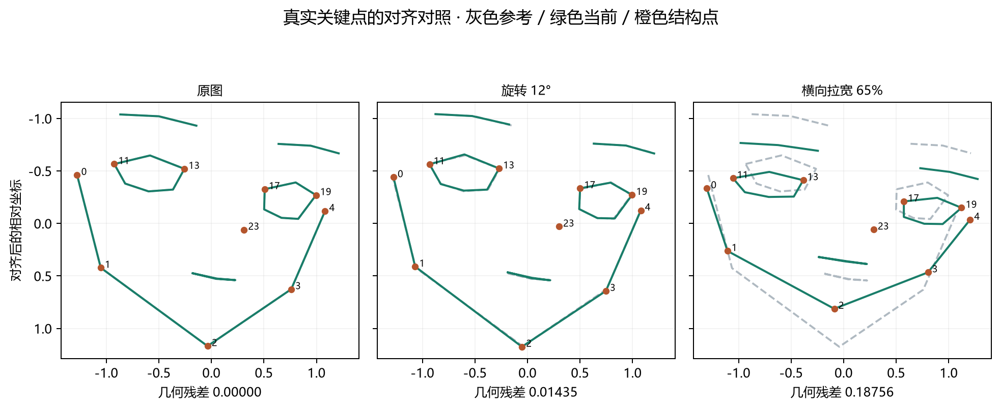
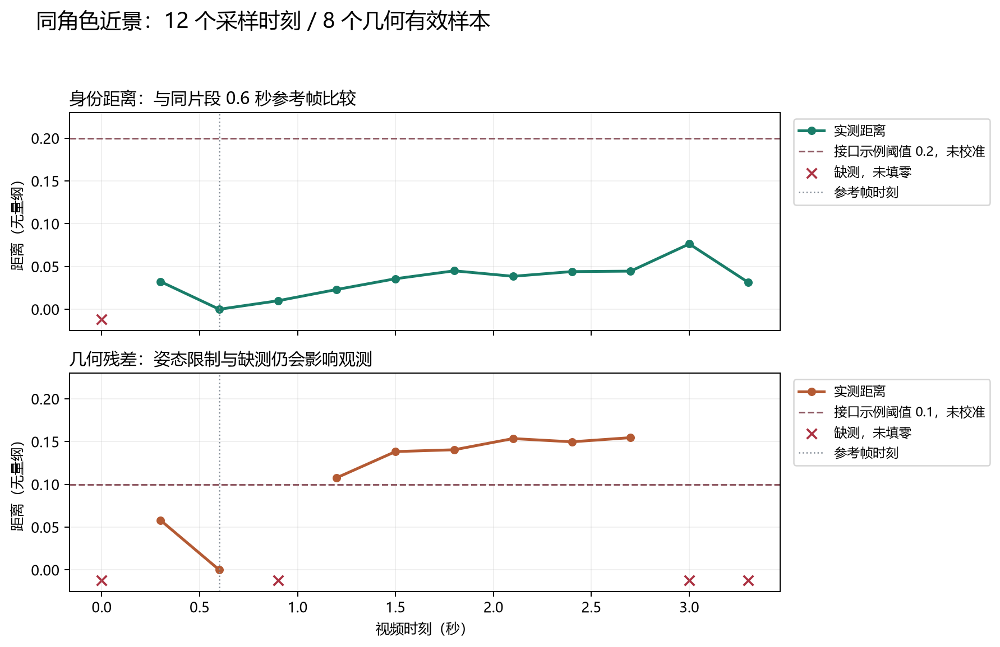
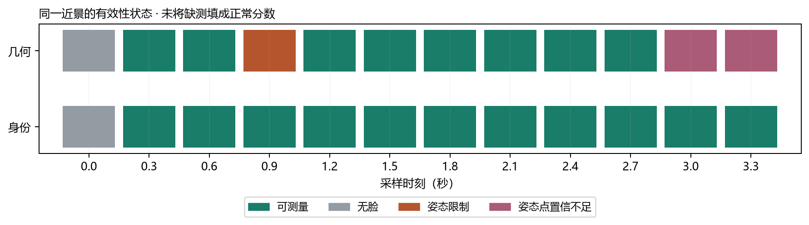

# #13 / #14 开发与实测报告

2026-10-12 · Anime Avatar Runtime · 研究分支提交版

**当前交付状态：模型与测量接口已经接入，真实 CPU 图片/视频样例已经跑通；异常判定仍是显式阈值比较，检测可靠性、实时性和自主恢复尚未验收。** 此前“完成”的表述指本地接入与接口实现，不能理解为整个异常检测系统已达到可用精度。

本报告回答四个问题：做了什么、实际测到了什么、结果有哪些限制、下一步该验证什么。数据来自现存 samples.jsonl、模型 manifest、环境记录、API 返回和源码。提交版数值与原记录一致，仅将原图换成数据示意并移除本机路径/运行身份；完整原始实验留在本地。报告整理时重新核对 GitHub，#13 与 #14 仍为 open；本报告随研究分支提交；PR 与远端 CI 状态以 GitHub 检查记录为准。研究范围未全部验收，不自动关闭 Issue。

## 1. 现在能直接做什么

| 能力 | 当前行为 | 能否使用 |
| --- | --- | --- |
| 动漫角色身份测量 | 使用 CCIP 提取 768 维特征，与显式选定的可信参考逐一比较，返回最小上游距离及匹配参考 | 可离线使用；样例验证已执行 |
| 面部几何测量 | 检测 bbox、28 点和置信度，去除平移、旋转与统一缩放，再计算结构残差 | 近正脸且置信度足够时可使用 |
| 表情变化记录 | 眉、眼睑和嘴部单独计分，不参与稳定结构的拟合 | 已实现；真实表情误报尚未做标注评估 |
| 图片/视频分析 | 命令行输入图片或抽样视频，保存逐时刻数据、特征、叠图和两条独立曲线 | 已实现并真实运行 |
| 手动 HTTP 观测 | 上传一帧，与初始化原图比较；Runtime 接收测量并记录事件 | 已跑通真实 CPU 处理链 |
| 异常判定 | 用户给定身份/几何阈值，各自比较；缺测或未给阈值返回 unknown | 接口可用；阈值未校准 |
| 自动恢复 / 连续生成观测 | 尚未接入自动循环，未实现滞回与持续时间规则 | 尚不能使用 |

工作流为：**输入图或采样帧 → 身份特征与人脸关键点 → 与参考比较 → 独立距离/缺测状态 → 显式阈值标志**。当前 Runtime 只接受手动结果，观测器不会自行暂停、重启或恢复生成器。

## 2. 实际测试了哪些输入

静态测试有 6 个样例：现有本地动漫图片作为参考；同图旋转 12°；同图全局横向拉宽约 65%；另一角色图片；空白图；上游公开多脸拼图。旋转/拉宽是人为控制变换，**不是本机生成模型自然产生的错误，也不是局部五官畸变数据集**。

视频测试使用官方公开 AniSora 演示 MP4，以及官方 `video_sr_video_3.gif` 中的单人近景。前者约 90.47 秒、每 5 秒采样；后者按 GIF 原始 duration 转码为 100 FPS MP4，在固定区域裁剪，时长 3.56 秒、每 0.3 秒采样。来源公开不等于素材可随项目任意分发；原始素材与叠图留在忽略目录。提交版只包含实际关键点示意、曲线、状态图与数值摘要，不包含私人角色图、视频截图或模型权重。

这轮没有在本机运行 SkyReels GPU 生成；公开视频样例不能替代目标生成端的长序列验收。视频帧还没有逐帧“正常/异常”人工标注，因此以下统计是测量与有效性统计，不是识别准确率。

## 3. 静态图结果：几何信号提供了什么补充

| 输入 | CCIP 身份距离 | 几何残差 | 几何状态 |
| --- | --- | --- | --- |
| 原图自身 | 2.941e-07 | 0.000000 | 几何可测 |
| 同图旋转 12° | 0.013689 | 0.014349 | 几何可测 |
| 同图横向拉宽 65% | 0.000011 | 0.187558 | 几何可测 |
| 不同角色 | 0.385593 | 不可用 | 不支持的姿态 |
| 空白图 | 不可用 | 不可用 | 未检出人脸 |
| 多脸拼图 | 不可用 | 不可用 | 多脸 |



图中为真实模型输出的 28 点，经与源码一致的置信度加权对齐后画在空白坐标系上。灰色是参考点形，绿色是当前点形，橙色标出结构点；没有嵌入原始动漫图。数值越大只表示与参考越不同，不能脱离阈值和输入条件直接读成“异常概率”。

**已观察到：**同图旋转的几何残差约 0.01435；全局拉宽的残差约 0.18756，约为前者的 13 倍。当前几何计算能在这个控制样例中保留比例变化，同时明显减弱旋转带来的变化。算法自动测试还验证了平移、统一缩放、旋转不变性及禁止镜像拟合。

**需要限制解释：**拉宽图 CCIP 距离接近零，与它的预处理有关。CCIP 将每张输入强制缩放到 384×384；全图横向拉伸后再缩回正方形，大部分拉伸会抵消。复核原图 768×768 和拉宽图 1267×768，在该预处理后的 RGB 像素平均绝对差只有 **0.162 / 255**。因此此例不能证明 CCIP 对局部五官变化也不敏感；后续仍应测试只改变眼距、鼻口位置和下巴轮廓的样例。

不同角色样例身份距离约 0.38559；几何检查将该帧判为姿态范围不支持，因此没有几何数值。该样例并不建立某个阈值对所有角色都适用。空白与多脸最终都记为不可用，避免将“能算出向量”当成“角色观测有效”。

## 4. 视频结果：可以测量的比例与实际波动

| 实验 | 身份可测 | 几何可测 | 其余几何状态 | 解释 |
| --- | --- | --- | --- | --- |
| 公开综合 MP4，19 个采样时刻 | 3/19 | 2/19 | 9 无脸、7 多脸、1 低置信/遮挡 | 标题、多人物和非人物场景很多；可测比例不是模型准确率 |
| 单人近景首次运行，首帧作参考，12 个时刻 | 11/12 | 0/12 | 首帧参考未检出可对齐人脸 | 参考无效会使整段几何测量不可用；失败记录保留 |
| 相同近景对照运行，0.6 秒输入帧作参考，12 个时刻 | 11/12 | 8/12 | 1 无脸、1 姿态不支持、2 姿态点置信不足 | 显式更换离线实验参考后，可以输出几何曲线；没有自动更新 Runtime 参考 |



曲线只连接相邻有效点，缺测以红色叉号表示。灰色竖线是 0.6 秒参考帧；自身距离接近零属于自比较，不是独立检测成功。图中的 0.2 / 0.1 虚线是 API 演示阈值，不是已经校准的默认阈值。

近景身份距离范围约 0–0.07638，几何残差范围约 0–0.15463。**8 个有效几何样本中有 6 个超过示例阈值 0.1。** 这个片段尚未人工标注，无法判断这些波动来自正常姿态、检测噪声还是真实畸变，因此不能将这 6 个点直接称为误报，也不能称为正确检出的异常。



首次参考漏检与后续姿态缺测不是无关小问题：它们意味着原始参考图必须有足够可信的几何测量，且当前系统需要把 unknown 交给后续策略处理。当前只报告缺测，不实现自动换参考、多脸分配或人脸追踪。

<details>
<summary>展开近景 12 个时刻的原始数值</summary>

| 时刻 / 秒 | 身份距离 | 几何残差 | 几何状态 |
| --- | --- | --- | --- |
| 0.0 | 不可用 | 不可用 | 未检出人脸 |
| 0.3 | 0.032349 | 0.058050 | 几何可测 |
| 0.6 | 1.634e-07 | 1.102e-15 | 几何可测 |
| 0.9 | 0.009938 | 不可用 | 不支持的姿态 |
| 1.2 | 0.023103 | 0.107778 | 几何可测 |
| 1.5 | 0.035689 | 0.138362 | 几何可测 |
| 1.8 | 0.044939 | 0.140466 | 几何可测 |
| 2.1 | 0.038545 | 0.153547 | 几何可测 |
| 2.4 | 0.044044 | 0.149756 | 几何可测 |
| 2.7 | 0.044555 | 0.154629 | 几何可测 |
| 3.0 | 0.076382 | 不可用 | 姿态点置信不足 |
| 3.3 | 0.031566 | 不可用 | 姿态点置信不足 |

</details>

## 5. 异常接口实际返回了什么

用 FastAPI TestClient 调用 HTTP 处理链，并在独立进程中执行真实 CPU 模型；对拉宽图设置身份阈值 0.2、几何阈值 0.1，返回 HTTP 200。以下摘录来自实际响应：

```json
{
  "identity_distance": 1.0946216207230464e-05,
  "geometry_distance": 0.1875576900591119,
  "identity_threshold": 0.2,
  "geometry_threshold": 0.1,
  "anomaly": {
    "status": "anomaly",
    "identity": "within",
    "geometry": "exceeded",
    "reasons": [
      "geometry: 0.187558 > 0.1"
    ]
  }
}
```

这里的 anomaly 表示“几何测量超过调用者给定的阈值”；它不是已训练分类器的判断，也不是恢复指令。`/observer/status` 可读回此次实测，参考 checkpoint 保持不变。未给阈值或测量缺失则保留 unknown；只有两条信号均有测量和阈值、且均未超限，才返回 within_thresholds。within_thresholds 也不等同已确认画面正常。

## 6. 代码交付和检查结果

| 位置 | 本次内容 |
| --- | --- |
| src/anime_avatar_runtime/observers.py | 模型固定与哈希校验、独立 CPU 进程、参考特征缓存、几何计算、视频采样、曲线和叠图 |
| contracts.py / config.py | 采样、测量、异常和结果契约；独立解释器、模型目录和超时配置 |
| runtime.py / api.py / cli.py | 手动观测接收、取消清理、HTTP 状态与异常接口、离线命令 |
| tests/test_observers.py | 新增 12 个算法/控制测试；与原有 43 项合计 55 项 |
| pyproject.toml / uv.lock | 基础 NumPy 和可选固定 CPU 观测环境；没有把模型装入 SkyReels 环境 |
| README / docs / .env.example | 安装、当前能力、模型许可、产物和失败边界同步 |

上一轮已执行的全套结果为：**55 passed；Ruff check 与格式检查通过；mypy 9 个源模块通过；wheel/sdist 构建通过；12 个本地文档链接检查通过。** 常规测试中的模型替身只验证契约、算法和控制行为，不能计为模型准确率。真实模型证据来自上述图片/视频实验；本次仅整理报告，没有重新跑全部模型和测试。

Windows 沙箱内两个既有进程树清理测试受权限限制，使用正常进程权限重跑后通过。当前改动没有新的 Linux 实际执行或远端 CI 证据。原始 CPU 实验在底座提交 `6912c0655b765c450ae58077bb0711aa89f50244` 加观测实现的本地快照上执行。发布研究分支基于 main 合并提交 `a5482ecf5b8a6a7d2f1e2a7caf2dd70f40555e27`，其底座文件与实验起点相同。`evidence.json` 保存实验源码快照与记录哈希；新增观测代码的提交版本以该研究分支 Git 历史为准，不将底座 SHA 冒充实现提交。

## 7. 对照 Issue 验收：哪些已有证据，哪些还差

| Issue / 验收项 | 当前证据 | 判断 |
| --- | --- | --- |
| #13：固定 CCIP 接口与权重、参考距离和匹配 | 固定上游函数、权重 revision、768 维缓存、逐帧记录 | 本地实现已完成 |
| #13：真实片段曲线和同角色 / 错角色样例 | 公开片段、控制变换、不同角色样例已有；本机 SkyReels 生成片段没有 | 公开样例阶段已有证据；生成端验收仍缺 |
| #13：缺帧/推理失败/embedding 无效不填正常值 | 缺测样例与行为测试，保留 unavailable | 已实现并验证 |
| #13：缓存随图像/模型变化失效，许可分别记录 | 缓存失效/损坏测试；MIT 代码与 OpenRAIL 权重分别记录 | 已实现并验证 |
| #14：28 点、bbox、置信度、对齐与几何漂移 | 实际叠图、结构/表情分离、加权相似拟合 | 本地实现已完成 |
| #14：相似变换不直接当结构错误、比例错误留残差 | 算法测试、真实旋转和全图拉宽对照 | 已验证有限样例；局部五官与真实表情评估不足 |
| #14：真实片段叠图与时间序列 | 综合演示和单人近景均有产物，明确有效/缺测比例 | 公开样例阶段已完成 |
| #14：无脸/多脸/不可对齐明确状态、环境与许可记录 | 失败例、独立状态、版本与 safetensors SHA-256 | 已实现并验证 |

本地工程接入与样例验证可以交给代码审查；**还没有证据支持“长期漂移识别可靠”“侧脸/遮挡可稳定使用”“实时运行达标”或“异常后能自动恢复”**。阈值校准本来也是后续实验任务，不能为了看起来完成而从这几张图推一个普适阈值。

## 8. 接下来最值得做的工作

| 顺序 | 工作 | 要得到的可验收结果 |
| --- | --- | --- |
| 1 | 补局部五官变形与正常表情/姿态对照 | 同角色多图；眼距、鼻口、下巴局部变化；眨眼/张嘴/转头；逐例标注与两类距离分布 |
| 2 | 在上述标注集上校准阈值与缺测策略 | 按角色/姿态报告有效率、误报/漏报；划分校准集与独立验证集；不能用 0.1 演示值直接上线 |
| 3 | 研究分支和 PR 的审查 | 本次发布实现与报告；Windows/Linux CI 以 PR 实际检查为准，保留未覆盖项，不合并 |
| 4 | 获取目标生成端片段，再推进 Observer/恢复 | 输入/模型/种子/硬件明确的 SkyReels 视频；之后接 #16/#17 的聚合、滞回和恢复决策 |

按当前证据，优先补第一项比直接增加自动恢复更有价值：否则恢复系统会放大尚未校准的几何波动。已有命令和处理链可以直接复用，不需要重新搭框架。

## 9. 环境、复查命令与证据入口

实测环境：Windows-11-10.0.26100-SP0，Python 3.12.13，Intel64 Family 6 Model 170 Stepping 4, GenuineIntel；CPU 推理，ONNX/PyTorch 各 2 个计算线程。本轮不报告 GPU 结果。

| 包 | 实测版本 |
| --- | --- |
| dghs-imgutils | 0.19.0 |
| anime-face-detector | 0.1.0 |
| numpy | 1.26.4 |
| torch | 2.5.1+cpu |
| torchvision | 0.20.1+cpu |
| onnxruntime | 1.31.0 |
| pillow | 12.3.0 |
| opencv-python-headless | 4.11.0.86 |

公开综合视频总运行约 76.64 秒；近景对照约 83.91 秒。总时间包含启动、模型加载、参考准备、采样和写盘，且同期有其他验证负载；不能据这些数值宣称串行吞吐或实时性能。近景首次运行约 39.36 秒，但几何全部缺测，不能用更短耗时评价质量。

本机复查近景的命令如下，输出目录必须未存在：

```powershell
uv run --locked avatar-runtime observe --python .tools/observer-env/Scripts/python.exe --video var/observer-assets/portrait-crop.mp4 --anchor var/observer-assets/portrait-reference-0600.png --sample-seconds 0.3 --max-samples 20 --output var/observer-experiments/recheck-portrait
```

| 证据 | 工作区路径 |
| --- | --- |
| 静态最终记录与原始叠图 | var/observer-experiments/static-v2 |
| 首帧参考失败记录 | var/observer-experiments/portrait-v1 |
| 近景对照、身份/几何曲线与逐帧值 | var/observer-experiments/portrait-v2 |
| 综合公开视频与缺测记录 | var/observer-experiments/public-demo-v1 |
| 实际 API 返回 | var/observer-experiments/api-response.json |
| 发布的数值/关键点/环境摘要及原记录哈希 | [evidence.json](./evidence.json)（去除本机绝对路径及运行身份） |
| 安装和接口详细说明 | [观测说明](../../observers.md) |

公开视频来源：[AniSora 固定 README](https://github.com/bilibili/Index-anisora/blob/6cdce3a17548d7ff0f2e05978469f134da25e68e/README.md)、[MP4 演示](https://github.com/user-attachments/assets/a207d43e-26f6-445b-883e-9b28c129607f)、[近景 GIF](https://raw.githubusercontent.com/bilibili/Index-anisora/6cdce3a17548d7ff0f2e05978469f134da25e68e/assets/video_sr_video_3.gif)。模型/代码版本固定方式、不同许可及权重 SHA-256 保存于 models/observers/manifest.json 和本报告旁 evidence.json。
