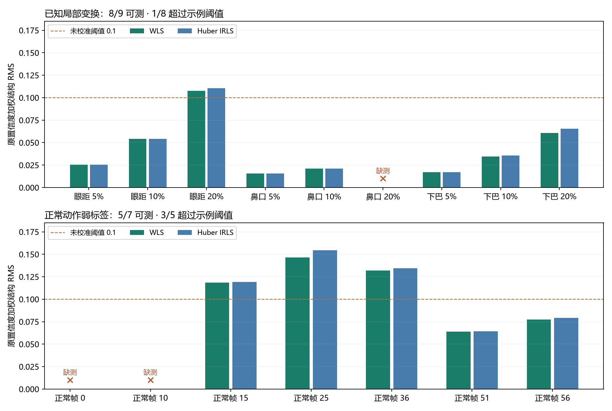
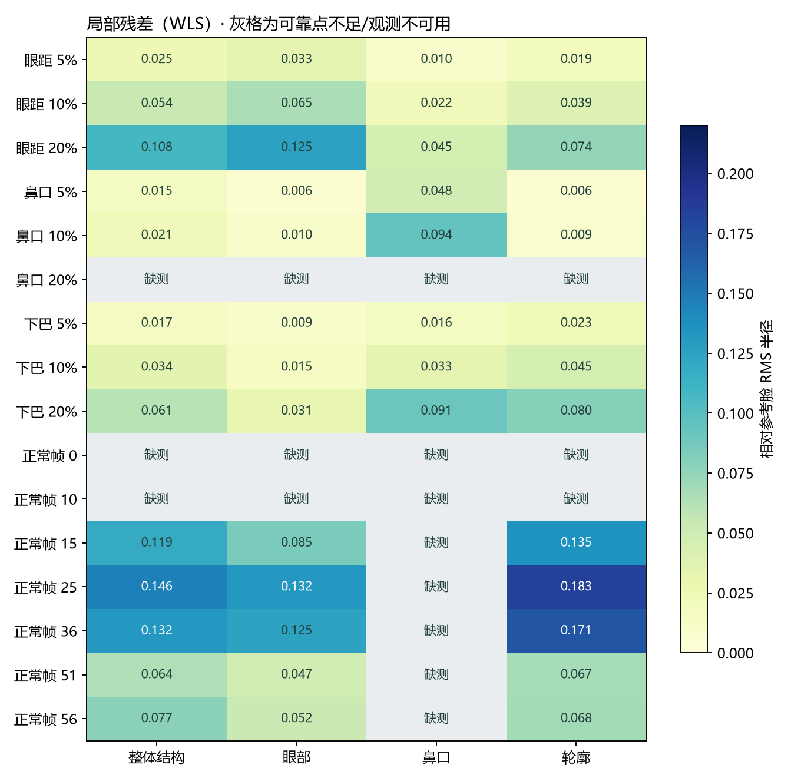

# PR #38：P0 修复与局部几何对照报告

2026-10-12 · 基于 e181817 的续作 · CPU 实测

**工程问题已修复；当前几何信号仍不足以直接触发自动恢复。** 身份候选现在独立于人脸检测，Runtime 观测不再长期持有控制锁，OpenCV 改为单一发行包。真实最小推理和主动取消通过。本轮对照没有证明 Huber IRLS 改善检测判定，因此保留原有加权最小二乘，只提交研究比较脚本与数值证据。

原始基线保留在 [首次报告](./README.md)；新证据见 [revision-evidence.json](./revision-evidence.json)。图片、视频、特征与原始叠图留在忽略目录，提交图表只来自真实数值和关键点，不含私人图片。

## 1. 三项 P0 的具体行为

| 修改 | 修订后的行为 | 限制 |
| --- | --- | --- |
| 身份与人脸解耦 | 无脸、多脸或检测器故障仍独立尝试 CCIP，保存 identity_candidate_distance 和特征 | 能算候选不等于目标存在 |
| 主体有效性 | subject_status / subject_face_count / subject_reason 单独记录；单脸代理通过才写 identity_distance 并进入阈值判定 | single_face_proxy 不是角色计数或目标追踪；多人全身图仍可能漏判 |
| 模型故障隔离 | 两组件分别校验、加载和输出；一套失败不阻止另一套，部分失败的 Anchor 不缓存 | 两套均不可用时运行失败，不伪造结果 |
| Runtime 控制 | 短锁注册任务，锁外准备图片/执行模型，短锁检查取消、修订、参考与结果身份后接收 | 当前仍是手动单帧接口，每次 HTTP 调用启动独立进程 |
| 暂停与关停 | 独立取消信号终止观测；锁外等待进程释放；进入停止阶段拒绝新任务 | 仍需 OS 允许清理拥有的进程树 |
| 过期结果 | run/avatar、参考哈希或 state_revision 不一致，取消/关停后的结果均拒收，HTTP 409 | 后端磁盘产物不等于 Runtime 已接收 |
| OpenCV | uv 锁定 opencv-contrib-python-headless 4.11.0.86，并排除三个竞争 provider | 上游 metadata 仍要求原包名，普通 pip 不执行 uv 排除规则 |

本进程 state_revision 在初始化、实际 resume 及 pause/close 时递增，重启从零开始；它与 checkpoint schema_version=1 不同。已接收测量带对应修订号，离线测量没有 Runtime 修订号。暂停和关闭请求即使被调用方取消，仍等待拥有的进程清理；迟到测量不更新 observer/status，也不产生 observation_recorded。

空白图实测候选距离 **0.333801**，多脸图 **0.312869**；两者可信身份与几何仍为 null，主体分别为 unverified / ambiguous。鼻口变形 20% 被几何姿态代理拒绝，但身份候选 **0.000133** 仍可独立记录。这些结果验证了候选与几何不再硬耦合，没有证明单脸代理已可靠识别目标角色。

OpenCV 替代使用 [uv exclude-dependencies](https://docs.astral.sh/uv/reference/settings/#exclude-dependencies)。安装环境实际只有一个 OpenCV distribution，cv2 4.11.0 可导入且 contrib 功能存在，两模型真实推理通过。`uv pip check` 仍报告 anime-face-detector 缺 opencv-python-headless、dghs-imgutils 缺 opencv-contrib-python 两个包名；这是未修改的上游 metadata 与替代 provider 的差异，不能写成 metadata 检查通过。

## 2. 对照输入、标签与算法

静态部分用现有单角色图，包含自比较、12° 旋转、9 个局部变换及空白/多脸主体对照。局部变换只移动眼部、鼻口或下巴附近像素，不改变画布大小，避免全图拉伸在 CCIP 384×384 预处理中被抵消。用检测出的双眼中心距离作为单位，做逆向 Gaussian 位移场，位移参数为眼距的 5%、10%、20%；眼距两侧向外移动，鼻口向右移动，下巴向下移动。Gaussian 标准差分别为眼距的 0.24、0.30、0.35，OpenCV 线性插值、反射边界；参数是位移场幅度，不等于所有关键点最终移动量。

正常动作部分使用同一公开 AniSora GIF，固定裁剪 `(700,320)-(1250,1000)`，GIF 第 5 帧为显式参考，评估第 0、10、15、25、36、51、56 帧，共 7 个独立样本。视觉逐例复核如下：

| GIF 帧 | 可见动作 | 几何状态 |
| --- | --- | --- |
| 0 | 半闭眼、轻微头部倾斜 | no_face |
| 10 | 睁眼、嘴部张开 | no_face |
| 15 | 嘴部闭合、眼睛看向一侧 | valid |
| 25 | 低头、视线向下 | valid |
| 36 | 低头与头部倾斜 | valid |
| 51 | 抬头、张嘴 | valid |
| 56 | 睁大眼睛、张嘴、轻微转头 | valid |

这些为单次视觉复核的弱标签：未见明显局部结构错误，不能保证公开视频没有细微生成错误。局部变换标签表示已知机械结构变化，也不等于每个轻微变换都被人视为异常。静态与正常动作来自两个角色，没有训练/校准集与独立测试集，本轮用于查找算法问题，不能作为模型总体精度。第 5 帧参考不计入正常样本分母。

保留失败运行：最初选择 GIF 第 10 帧作为参考时没有可对齐人脸，正常动作几何全部缺测。该次运行仍存于 `var/observer-experiments/p0-local-geometry-v1`；修订对照另选第 5 帧，不覆盖旧产物，也不自动更换 Runtime Anchor。

WLS 复现现有 10 个结构点、置信度权重、禁止反射的相似变换，与生产 geometry_distance 逐例核对一致。研究 Huber IRLS 使用固定 delta=0.05 个参考 RMS 半径、最多 20 次迭代，按 `w_i * min(1, delta/r_i)` 更新拟合权重。最终结构及局部残差仍用**原始置信度权重**计算，避免把真实结构畸变当作离群点从评分中删除。眼部使用点 11–22，鼻口 23–27，轮廓 0–4；局部至少 3 个可靠点，不足则 null。局部残差不参与 Runtime 判定。

## 3. 有效率、示例判定和变形强度



虚线 0.1 沿用原接口演示值，**没有重新校准或写入默认配置**。缺测明确留空。

| 样本组 | 几何有效率 | WLS 超过 0.1 | Huber 超过 0.1 | 仅在本组标签下的说明 |
| --- | --- | --- | --- | --- |
| 已知局部变换 | 8/9（88.9%） | 1/8（12.5%） | 1/8（12.5%） | 7/8 有效变换未超限；另 1 个姿态拒绝不能算正常 |
| 视觉复核正常动作 | 5/7（71.4%） | 3/5（60.0%） | 3/5（60.0%） | 弱标签下有 3 个候选误报；另 2 个检测缺测 |

若将受控变换全部当作正类，则有效样本上的示例漏报率是 7/8；若将视觉标签全部当作负类，则示例误报率是 3/5。这两个比率必须与缺测分母、弱标签及不同角色一起解读，不是部署精度，也不是独立验证集结果。

| 局部变换幅度 | 有效样本 | WLS 检出 | Huber 检出 |
| --- | --- | --- | --- |
| 5% 眼距 | 3/3 | 0/3 | 0/3 |
| 10% 眼距 | 3/3 | 0/3 | 0/3 |
| 20% 眼距 | 2/3 | 1/2 | 1/2 |

只有 20% 的眼距变化超过结构阈值；20% 鼻口移动被 unsupported_pose 拒绝。鼻口移动 10% 的整体残差只有 **0.02108**，鼻口局部残差却达到 **0.09418**；下巴 20% 的整体残差 **0.06078**，轮廓局部 **0.07957**。整体结构点平均会稀释局部变化。



正常动作的鼻口局部残差全部缺测，因为可靠鼻口点不足；不能用当前数据宣称这一局部指标能区分张嘴和畸变。轮廓受低头/转头影响明显，固定“稳定点”集合并不保证跨姿态稳定。CCIP 对这 9 个局部变换的候选距离约 **0.000021–0.003283**，说明身份距离没有代替结构测量。

## 4. 为何本次保留原算法

Huber 在部分样本中降低了未变形区域的残差，例如下巴 20% 变换的眼部残差由 0.03080 降至 0.01770；但整体结构残差由 0.06078 升至 0.06542。正常样本也没有减少超限数；第 25 帧由 0.14648 升至 0.15435。某些样本达到 20 次迭代上限，结果保留迭代数，不宣称全部收敛。

这与目标函数一致：原 WLS 已最小化固定权重的全局平方残差；改变拟合权重后仍按原权重计分，不能期望整体 RMS 比 WLS 更小。IRLS 的价值可能在于保护未畸变部位的对齐、帮助定位问题；它并没有在这轮数据上证明能降低误报且保持检出。若直接把鲁棒后的低权重点从评分中剔除，则可能同时隐藏真实五官错误，因此本次没有这样做。

判断是继续研究局部特征、姿态条件和关键点可靠性，按角色/动作建立标注集后校准。仅用 Huber 替换拟合不能解决当前判定问题。#16 可接收三类独立信号，但时序融合不能被当作单帧精度问题已解决的证据。

## 5. 推理成本与真实 Runtime 取消

本轮串行执行 20 个图片样本，共 **70.03 秒**，模型校验/加载 **10.51 秒**；一进程复用模型，期间另有控制测试，未固定系统负载。样本身份阶段中位数 **0.453 秒**，几何阶段中位数 **1.453 秒**，范围分别约 0.375–0.844 和 1.016–9.719 秒；最大几何耗时来自高分辨率多脸图。阶段耗时包含模型与距离计算，整段还包含参考准备、写图和其他开销，不能用来与旧 83.91 秒作性能提升比较。

这些 CPU 成本仍不适合同步逐帧观测。长期 Observer Worker 可以减少初始化开销，但本次没有实现 Worker、关键点追踪或自适应采样，仍留给独立 PR。

另用真实 Runtime 与真实模型环境启动观测，在 models.json 已写出、模型加载完成后请求 pause：主动终止拥有的进程，暂停返回耗时 **0.688 秒**；观测返回 RuntimeConflict，observation_active=false、模式 paused、修订号 2，checkpoint 哈希未变，observation_recorded 事件为 0。后端 run.json 记 failed 并记录取消错误，未被 Runtime 接收为成功。此单次 Windows 清理结果不是所有 OS 或负载下的延迟保证，也不是 GPU 结果。

## 6. 验证范围与复查

本地常规验收 **69 passed，1 skipped**；跳过项为显式 opt-in 的真实模型测试。Ruff、格式、mypy 9 个源模块及 wheel/sdist 构建通过。控制测试覆盖独立模型失败、部分 Anchor 失败不缓存、身份候选和主体分离、重复观测/生成互斥、pause/close/resume、调用方取消和状态修订拒收；研究测试验证 WLS 与原实现一致及 IRLS 不丢弃异常评分。Windows 进程树测试在正常进程权限下执行。

显式配置真实近正脸图片后，最小推理测试另行 **1 passed**：真实子进程执行固定模型，检查 768 维非零有限特征、28 点、单脸主体代理、自比较距离和固定来源。常规测试的模型替身只验证控制行为。远端检查以同一 [PR #38](https://github.com/proffitteoy/anime-avatar-runtime/pull/38) 的当前 head/Checks 为准；旧 e181817 的 CI 不能替代本次提交。PR 保持 Draft，不合并、不自动关闭 #13/#14。

研究入口为 [observer_geometry_experiment.py](../../../scripts/observer_geometry_experiment.py)，在独立模型环境运行；输出目录须不存在：

```powershell
.tools/observer-env/Scripts/python.exe scripts/observer_geometry_experiment.py --models models/observers --anchor var/observer-assets/local-anchor.png --normal-gif var/observer-assets/anisora-portrait.gif --crop 700 320 1250 1000 --blank var/observer-assets/no-face.png --multiple var/observer-assets/face-detector-input.jpg --output var/observer-experiments/recheck-local-geometry
```

需由素材持有者准备相同输入；源哈希、裁剪/帧号、模型来源、实现哈希和逐样本关键点都在新证据文件中，原图不随仓库分发。所有变换确定性，无随机种子。模型 CPU 环境：Windows 11、Python 3.12.13、NumPy 1.26.4、Torch 2.5.1+cpu、torchvision 0.20.1+cpu、ONNXruntime 1.31.0；ONNX/PyTorch 各 2 个计算线程。

公开视频仍来自 [AniSora 固定版本 GIF](https://raw.githubusercontent.com/bilibili/Index-anisora/6cdce3a17548d7ff0f2e05978469f134da25e68e/assets/video_sr_video_3.gif)。目标 SkyReels GPU 片段、长期稳定性、真实生成异常标签、校准/验证集划分、不同姿态适用性及 #16/#17 时序检测与恢复未验收。下一步应补这些输入与标签，再比较局部/姿态特征；本轮结果不支持直接开启自动恢复。
